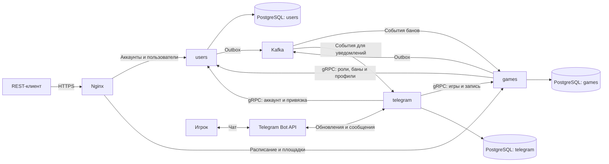

# Архитектура VolleyBOT

В основе этапа 03 — [дорожная карта README](../README.md#этапы) и [правила клуба](domain.md). Игроки пользуются Telegram-ботом, модераторы и администратор — REST API. Веб-клиент обсудим отдельно.

## Сервисы и данные

| Сервис | За что отвечает | Что хранит |
| --- | --- | --- |
| `users` | Регистрация и вход, сессии, профили, роли, баны, привязка Telegram и настройки уведомлений | Учётные записи, refresh-токены, баны, привязки и настройки |
| `games` | Площадки и залы, игры и серии, запись и лист ожидания, перемешивание, явка и расчёт дисциплины | Расписание, записи, версии составов и отметки явки |
| `telegram` | Команды и кнопки бота, доставка уведомлений, напоминания | Задания доставки, ключи дедупликации и статусы попыток |

У каждого сервиса своя база PostgreSQL и свои миграции. Для локального запуска базы размещаются в одном экземпляре PostgreSQL. Сервисы получают чужие данные через gRPC или события Kafka. Форматы игр и алгоритм перемешивания принадлежат `games`. Профиль игрока, его текущая роль и бан принадлежат `users`.

## Взаимодействия

Nginx даёт один внешний адрес REST API и направляет запросы в сервис, которому принадлежат данные. Каждый сервис проверяет права на свои операции. Регистрация и получение одноразовой ссылки для привязки Telegram доступны через REST в `users`. Внутренний gRPC доступен сервисам в закрытой сети. `telegram` определяет пользователя по привязанному `chat_id` через `users` и передаёт его идентификатор в `games` по доверенному внутреннему каналу. `games` проверяет актуальные права и состояние игры независимо от кнопок, показанных ботом.

## Ключевые сценарии

- **Запись на игру.** Бот передаёт команду в `games`. Сервис проверяет пользователя и окно записи, блокирует строку игры в транзакции, сохраняет запись и событие в outbox. Он возвращает место в основном составе или позицию в листе ожидания. Повторная команда возвращает существующую запись. При отмене состав пересчитывается по порядку записей, а событие перевода позволяет уведомить игрока.
- **Перемешивание.** Модератор вызывает REST в `games`. Сервис проверяет владельца игры, берёт основной состав и профильные данные из `users`, сохраняет новую версию составов и публикует событие через outbox.
- **Бан.** `users` применяет бан и сохраняет событие в той же транзакции. Защищённые операции учитывают бан при проверке пользователя. По событию `games` снимает игрока с ещё не начавшихся игр, попадающих в период бана, и освобождает места для листа ожидания. `telegram` отправляет уведомление.
- **Явка.** Модератор отмечает явку основного состава в `games` с момента начала игры. Неявка определяется после окончания игры. `games` рассчитывает дисциплину и при срабатывании правила запрашивает автобан у `users`.
- **Уведомление.** `telegram` сохраняет задание по событию Kafka, учитывает привязку и настройки пользователя и повторяет временно неудавшуюся доставку. Планировщик напоминаний получает из `games` актуальное время игры и её основной состав.

## Порядок внедрения

- Этап 06 даёт каркас монорепозитория, PostgreSQL и Nginx. Ядро `users` и `games` последовательно открывает REST API к вехе `v0.1.0`.
- Этапы 15–18 добавляют публикацию из outbox в Kafka, привязку Telegram, бот, уведомления и дисциплину к вехе `v0.2.0`.
- Этапы 19–21 добавляют Redis, метрики и нагрузочные проверки. При недоступности Redis сервисы обращаются к исходным данным. При недоступности Kafka события ждут публикации в outbox. При недоступности Telegram Bot API уведомления ждут в заданиях доставки.

## Архитектурные решения

- [0001. Три сервиса в монорепозитории](adr/0001-three-services-in-monorepo.md)
- [0002. Kafka и transactional outbox](adr/0002-kafka-and-transactional-outbox.md)
- [0003. JWT, сессии и проверка прав](adr/0003-jwt-and-authorization.md)
- [0004. Ограничение пересечений по залу](adr/0004-hall-overlap-exclusion.md)

OpenAPI, protobuf и каталог событий входят в этап 04. Модель данных, миграции и план фикстур входят в этап 05.
