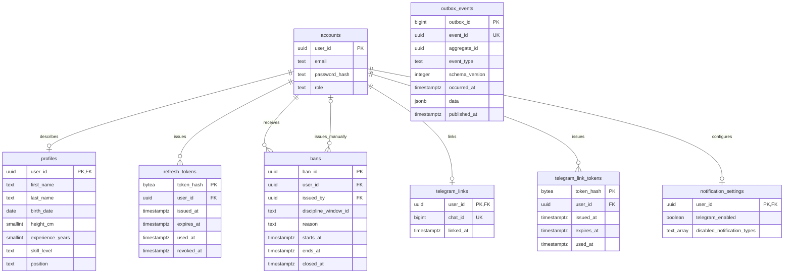
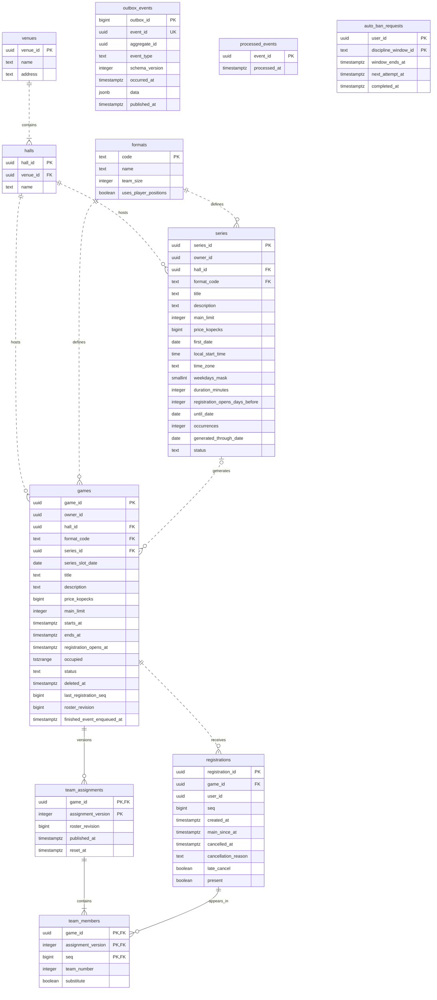
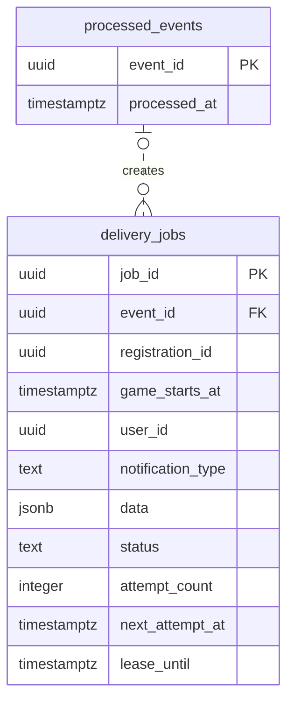

# Модель данных PostgreSQL

Три базы принадлежат сервисам [users, games и telegram](architecture.md#сервисы-и-данные). В локальной среде они могут работать в одном экземпляре PostgreSQL. В каждой базе свои роли и миграции. Межсервисные идентификаторы сохраняются как значения без внешних ключей и межбазовых JOIN. Владелец проверяет существование и права через [REST и gRPC](contracts.md#rest-и-grpc), а изменения распространяет через [Kafka](events.md).

Идентификаторы доменных сущностей и событий — UUID, представленные непрозрачными строками на границе API. Идентификатор чата — `bigint`. Моменты времени — `timestamptz`, местные даты и время серии — `date` и `time`. Поля обязательны, кроме явно отмеченных в тексте. В диаграммах `PK` обозначает первичный ключ, `FK` — локальный внешний ключ, `UK` — уникальность. Для составных ключей и частичных индексов точный набор полей приведён под диаграммой. Обычные локальные FK ограничивают удаление родителя.

## users

Владеет аккаунтами, профилями, ролями, refresh-токенами, банами, привязками Telegram и настройками уведомлений. Остальные сервисы читают доступное им представление через [users.proto](../api/proto/volleybot/users/v1/users.proto).



| Таблица | Ограничения, индексы и назначение |
| --- | --- |
| `accounts` | Уникальный индекс `lower(email)` для входа и регистрации. `role` из `user`, `moderator`, `admin`. Пароль хранится в виде хеша. |
| `profiles` | Строка необязательна, `position` может быть `NULL`. Проверки на непустые имена, рост 100–250, опыт 0–60, уровень и амплуа по [OpenAPI](../api/openapi/volleybot.v1.yaml). Сервис проверяет дату рождения при записи и подставляет публичное имя без раскрытия email для незаполненного профиля. |
| `refresh_tokens` | Хеш непрозрачного секрета — ключ поиска. `expires_at > issued_at`, `used_at` и `revoked_at` могут быть `NULL`. Индекс `(user_id) WHERE used_at IS NULL AND revoked_at IS NULL` для отзыва всех неиспользованных токенов аккаунта. Сохраняем хеши использованных токенов, чтобы распознавать повтор независимо от срока их действия. |
| `bans` | Непустая причина, `ends_at IS NULL OR ends_at > starts_at`, `closed_at IS NULL OR closed_at >= starts_at`. Ровно одно из полей `issued_by` и `discipline_window_id` заполнено. Уникальный частичный индекс `(user_id) WHERE closed_at IS NULL` для поиска открытой записи бана. `UNIQUE (user_id, discipline_window_id)` для повтора запроса автобана. Индекс `(user_id, starts_at DESC) WHERE discipline_window_id IS NOT NULL` для проверки последнего автобана, включая снятые. |
| `telegram_links`, `telegram_link_tokens` | Два направления поиска привязки покрыты PK по `user_id` и UK по `chat_id`. У токена `expires_at = issued_at + interval '10 minutes'`, `used_at` может быть `NULL`. Для очистки используется индекс `(expires_at)`. |
| `notification_settings` | `disabled_notification_types` имеет тип `text[]`. Сервис проверяет допустимость типов и отсутствие дублей по контракту. При отсутствии строки сервис возвращает значения по умолчанию. Настройки сохраняются при отвязке чата. |
| `outbox_events` | Общие ограничения и индекс описаны в разделе [событий](#события-и-повторы). `aggregate_id` — ключ Kafka. |

| Инвариант | PostgreSQL | Транзакция `users` |
| --- | --- | --- |
| Refresh используется один раз | Уникальный хеш и блокировка строки аккаунта позволяют сериализовать выдачу и отзыв его токенов. | На входе, выходе и обновлении блокирует аккаунт, после ожидания читает состояние токена заново. При успешной ротации в одной транзакции выставляет `used_at` и вставляет новый хеш. При повторе использованного токена отзывает все ещё пригодные refresh, включая только что выданного преемника, **фиксирует** отзыв и только потом возвращает `invalid_refresh_token`. Неизвестный, отозванный или просроченный неиспользованный токен не ротируется. |
| Один активный бан и корректное истечение | Частичный UK допускает одну открытую строку на пользователя; `CHECK` проверяет границы периода. | Блокирует аккаунт, проверяет полномочия и срок по времени после блокировки, закрывает предыдущую открытую строку и вставляет новый бан. Активность определяется как `closed_at IS NULL AND starts_at <= now AND (ends_at IS NULL OR now < ends_at)`. Истечение не требует фонового обновления. Ручное снятие закрывает строку и пишет `user.unbanned` с этапа 15. Повтор автобана проверяется по ключу окна, а новую выдачу блокируют действующий бан и интервал с последней выдачи автобана, включая снятый. |
| Одноразовая привязка | Хеш токена уникален; уникальны обе стороны привязки. | Под блокировкой аккаунта связывает чат и помечает токен использованным в одной транзакции. Уникальность `chat_id` защищает от попыток привязки того же чата к двум аккаунтам. Ошибка откатывает потребление токена. |

Сервис проверяет правила изменения ролей, в том числе выдачу `admin` только через CLI и недопустимость бана администратора. Действующие баны и роли читаются из `users` при защищённых действиях по [ADR 0003](adr/0003-jwt-and-authorization.md).

## games

Владеет площадками, залами, форматами, расписанием, сериями, записями, раскладами и явкой. `owner_id` и `user_id` ссылаются на идентификаторы из `users` без FK. Данные профиля для перемешивания читаются через gRPC.



| Таблица | Ограничения, индексы и назначение |
| --- | --- |
| `venues`, `halls` | Непустые имя и адрес площадки, непустое имя зала. `UNIQUE (venue_id, name)`. Индекс `(venue_id, hall_id)` даёт список залов с пагинацией; PK площадки даёт порядок списка площадок. Сервис создаёт площадку с первым залом одной транзакцией и под блокировкой площадки проверяет удаление последнего зала. FK защищают залы с играми, включая историю, и залы серий. Удаление площадки без игр удаляет её залы в одной транзакции при отсутствии ссылок серий. |
| `formats` | Справочник с PK по коду, положительным `team_size` и FK из игр и серий. Начальные коды — `classic_6x6`, `quads_4x4`, `beach_2x2`. |
| `series` | Непустой заголовок, неотрицательная цена и отступ открытия записи, положительный лимит, длительность 30–360 минут, семибитная маска дней от 1 до 127. `until_date` и `occurrences` допускают `NULL`, одновременно задаётся максимум одно поле. Дата окончания включительна и не раньше `first_date`, число повторений положительно. `status` из `active`, `ended`, `cancelled`. `generated_through_date` может быть `NULL` до первой обработки. Индексы `(owner_id, series_id)` для списка модератора и `(generated_through_date, series_id) WHERE status = 'active'` для генератора. Для проверки ссылок на залы — `(hall_id)`. |
| `games` | Непустой заголовок, `main_limit >= 1`, `price_kopecks >= 0`, длительность 30 минут–6 часов, `registration_opens_at <= starts_at`. `status` из `scheduled`, `cancelled`. У разовой игры `series_id` и `series_slot_date` оба `NULL`, у экземпляра оба заданы. `UNIQUE (series_id, series_slot_date)`. `deleted_at` и маркер постановки `game.finished` до соответствующей операции равны `NULL`. Счётчики начинаются с 0 и неотрицательны. |
| `games`, запросы | `(starts_at, game_id) WHERE status = 'scheduled' AND deleted_at IS NULL` для предстоящих игр и кандидатов на напоминание; текущая граница времени — параметр запроса. `(ends_at, game_id) WHERE status = 'scheduled' AND finished_event_enqueued_at IS NULL` для завершённых игр без события. `(hall_id)` для проверки ссылок и истории зала. |
| `registrations` | `UNIQUE (game_id, seq)` и `seq > 0`. Уникальный индекс `(game_id, user_id) WHERE cancelled_at IS NULL`. `(game_id, seq) WHERE cancelled_at IS NULL` для вычисления состава. `(user_id, game_id, registration_id)` для истории игрока и выборки дисциплины, с JOIN и сортировкой по `(games.starts_at DESC, registration_id DESC)`. `(user_id, game_id) WHERE cancelled_at IS NULL` для обработки бана. |
| `registrations`, отмена и явка | `cancelled_at` и `cancellation_reason` заданы вместе либо оба `NULL`; причина из `self`, `ban`, `game_cancelled`. `late_cancel` и `present` по умолчанию `false`. Поздняя отмена допустима только при причине `self`, отменённая запись не может иметь `present=true`. `main_since_at` может быть `NULL`. |
| `team_assignments`, `team_members` | PK версии `(game_id, assignment_version)`. PK участника `(game_id, assignment_version, seq)`, FK на версию `(game_id, assignment_version)` и на запись `(game_id, seq)`. Номер команды и версия положительны. `reset_at` может быть `NULL`. PK версии используется для поиска последней опубликованной версии. |
| События и запросы автобана | `processed_events.event_id` уникален для группы потребителя `games`. Для ожидающих запросов к `users` — индекс `(next_attempt_at, user_id, discipline_window_id) WHERE completed_at IS NULL`. Остальные поля и протокол описаны в разделе [событий](#события-и-повторы). |

### Расписание

Колонка `occupied` вычисляется как `tstzrange(starts_at, ends_at, '[)')` в `GENERATED ALWAYS AS (...) STORED`. Точное ограничение из [ADR 0004](adr/0004-hall-overlap-exclusion.md):

```sql
CREATE EXTENSION IF NOT EXISTS btree_gist;
ALTER TABLE games ADD CONSTRAINT games_hall_occupied_excl
  EXCLUDE USING gist (hall_id WITH =, occupied WITH &&)
  WHERE (status = 'scheduled' AND deleted_at IS NULL)
  DEFERRABLE INITIALLY IMMEDIATE;
```

| Инвариант | PostgreSQL | Транзакция `games` |
| --- | --- | --- |
| Зал не занят двумя играми | GiST проверяет пересечения даже между конкурентными записями. Граница `[)` разрешает стык. `scheduled` включает уже начавшиеся и прошедшие игры, пока они в расписании. | Перенос блокирует игру и проверяет право и допустимый момент изменения. Ошибка ограничения `23P01` преобразуется в `hall_time_conflict` с играми того же зала. Создание и перенос используют один механизм. Отмена или удаление освобождает зал при коммите. |
| Серия не дублирует слот | Уникальный ключ `(series_id, series_slot_date)` сохраняется при переносе одной игры, отмене или [удалении](adr/0005-retain-deleted-games.md). | Генератор под блокировкой серии заполняет местные даты до горизонта четырёх недель. `registration_opens_at` получается вычитанием местных календарных дней до перевода во время UTC. При конфликте слота с другой игрой откатывает вставку до savepoint, записывает пропуск в outbox с этапа 15 и продвигает `generated_through_date` в той же транзакции. Пропуск входит в количество запланированных повторений. |
| Деление серии целиком | GiST ограничивает итоговые интервалы; PK сохраняет идентичность каждой игры. | Блокирует родительскую серию и затронутые игры в порядке `game_id`, повторно проверяет сроки и формирует новые слоты. Переносит выбранную и следующие ещё доступные для игры строки по порядку старых слотов, сохраняя `game_id` и записи. Модератор получает ошибку, если слотов не хватает. Старая серия обрезается накануне старого слота. Отложенная до конца операции проверка GiST позволяет массовый перенос без конфликтов с промежуточным состоянием. Сервис проверяет весь план на конфликты, затем выполняет `SET CONSTRAINTS games_hall_occupied_excl IMMEDIATE` перед коммитом. При обнаружении конкурентного пересечения весь перенос откатывается, а список конфликтов читается по плану и текущему расписанию. |
| Удаление и завершение | История и ключ слота остаются в таблице, FK продолжают её защищать. | При удалении под блокировкой проверяет статус игры и отсутствие активных записей, если она не отменена, затем выставляет `deleted_at`. Удалённая игра доступна в истории собственных записей, а её проведённая явка остаётся в расчёте дисциплины. `in_progress` и `finished` вычисляются по `starts_at` и `ends_at`. |

Сервис проверяет IANA-часовой пояс и соответствие первой местной даты дням недели. Местное время переводится в момент через PostgreSQL `AT TIME ZONE` с одной и той же политикой переходов для начала и открытия записи. Отменённые и удалённые экземпляры остаются в старой серии при её делении. Старая серия получает статус `ended`; при делении на первом слоте одной смены статуса достаточно, чтобы не задавать недопустимую дату окончания. Новая серия начинает отсчёт повторений с нового первого слота. При унаследованном ограничении числа повторений ей передаётся остаток запланированных слотов, начиная с выбранного. Маркер генерации новой серии учитывает перенесённые слоты.

### Запись, состав и явка

Во всех командах, меняющих запись, состав, явку или расклад, сервис берёт блокировку строки игры. После ожидания читает актуальное состояние и фиксирует единое время решения через `clock_timestamp()`. Основной состав — первые `main_limit` неотменённых записей по `seq`. Этот набор замораживается при начале игры: ограничения по времени прекращают изменения состава, а наличие явки не меняет порядок. Игрок из листа ожидания после окончания не участвует в дисциплине. Список для напоминаний ранжируется по `seq`, а затем выбранные записи выдаются по `(starts_at, game_id, registration_id)` согласно [games.proto](../api/proto/volleybot/games/v1/games.proto).

| Инвариант | PostgreSQL | Транзакция `games` |
| --- | --- | --- |
| Одна активная запись и монотонный `seq` | Частичный UK по игроку, UK по номеру внутри игры, блокировка игры. | Проверяет актуальные права, бан и состояние игры, возвращает существующую активную запись при повторе. При создании проверяет `registration_opens_at <= now < starts_at`, увеличивает `last_registration_seq` и записывает полученный номер в той же транзакции. Отменённые строки и номера сохраняются. |
| Продвижение и поздняя отмена | Уникальный `seq` даёт однозначный порядок. Связность полей и допустимая причина отмены проверяются ограничениями. | Сравнивает основной состав до и после изменения. При входе в него задаёт `main_since_at`, при выбытии очищает. Поздний самоотказ считается, если игрок в основном составе, `now > starts_at - interval '3 hours'` и `main_since_at < starts_at - interval '3 hours'`. За ровно 3 часа штрафа нет. Изменение состава, времена входа и события `registration.promoted`/`demoted` фиксируются вместе. Первая запись нового игрока сама по себе не считается продвижением. |
| Отмена адресуется к одной записи | `registration_id` — PK, у новой записи другой идентификатор. | Под блокировкой игры проверяет соответствие `game_id` и владельца записи. Повтор самоотмены возвращает сохранённый результат, даже если игрок снова записался. Для перехода из активной записи дополнительно проверяет `now < starts_at`, сохраняет отмену и события один раз. При отмене всей игры сервис сначала фиксирует получателей, затем отменяет её записи с `reason=game_cancelled` без штрафов и продвижений. |
| Временный бан снимает только с затронутых игр | Локальная транзакция атомарно сохраняет отмены, переводы, outbox и отметку обработки. В базе `games` отсутствует источник истины о бане. | Запись и обработчик `user.banned` берут одну advisory-блокировку на `user_id` перед блокировками игр. Обработчик выбирает неотменённые записи, блокирует игры по `game_id`, запрашивает актуальный `ban_id` в `users` и проверяет диапазон `starts_at_ban <= game.starts_at < ends_at_ban` плюс `now < game.starts_at`. При бессрочном бане верхней границы нет. Для снятого, истёкшего или заменённого бана обработчик пропускает отмену. Под блокировкой перенос игры с изменением времени проверяет актуальные баны записанных игроков и применяет это правило к новому времени, чтобы перенос внутрь бана после обработки события не сохранил запись. Отмена по бану не даёт штрафа. |
| Версия расклада и устаревание | PK по версии и уникальность участия, два FK для связи версии и игрока с той же игрой. | Проверяет доступность перемешивания и минимум 4 игрока в основном составе, публикует следующую версию под блокировкой игры. Увеличивает `roster_revision` при каждом изменении набора основного состава. Несовпадение ревизий означает устаревший расклад. Смена формата выставляет `reset_at` у последней отображаемой версии, сохраняет историю и публикует `teams.reset` с этапа 15. Поиск сначала выбирает последнюю версию, затем проверяет сброс. |
| Одна актуальная отметка явки | Одно поле `registrations.present` на запись и `CHECK`, запрещающий явку у отменённой записи. | Проверяет владельца и принадлежность основному составу в окне `[starts_at, ends_at + 7 суток)`. Повтор той же отметки ничего не меняет; `present=false` снимает явку. После окончания отсутствие явки у игрока основного состава даёт `no_show`. Игроки листа ожидания не получают `no_show`. После исправления у завершённой игры сервис публикует `attendance.changed` в той же транзакции. |

С момента применения бана в `users` новые защищённые вызовы проверяют актуальный статус. Между этой проверкой и коммитом `games` бан может измениться: общей транзакции у двух баз нет. Блокировки и обработка события закрывают гонку записи с асинхронным снятием; ошибка gRPC оставляет событие на повтор. Снятие или истечение бана само по себе не восстанавливает отменённую запись.

## telegram

Владеет очередью доставки и отметками обработки. `user_id` получен из `users`, `registration_id` — из `games`, `event_id` — из Kafka. У таких полей нет FK на чужие базы. Чат и настройки запрашиваются в `users` перед доставкой; адрес чата в задании не хранится.



- У задания по событию задан локальный FK `event_id` на `processed_events`, `registration_id` и `game_starts_at` равны `NULL`. Частичный UK `(event_id, user_id) WHERE event_id IS NOT NULL` покрывает повтор события.
- У напоминания `event_id` равен `NULL` и обязательна пара `(registration_id, game_starts_at)`, на неё наложен частичный UK `WHERE event_id IS NULL`. Планировщик ставит задание за 24 часа до начала. Перед отправкой сверяет текущее время старта и основной состав через `GetReminderCandidate`; потерявшее актуальность задание завершает как пропущенное.
- `status` из `pending`, `sending`, `sent`, `skipped`, `failed`. `attempt_count >= 0`, `lease_until` обязателен только для `sending`. Индексы `(next_attempt_at, job_id) WHERE status = 'pending'` и `(lease_until, job_id) WHERE status = 'sending'` дают готовые задания и просроченные захваты. `data` содержит только нужные для формирования сообщения значения из события.

## События и повторы

| Инвариант | PostgreSQL | Сервис и внешние границы |
| --- | --- | --- |
| Событие переживает сбой издателя | Изменение сущности и строка outbox атомарны. `event_id` уникален, `outbox_id` — `bigint GENERATED ALWAYS AS IDENTITY`, `schema_version > 0`, `published_at` до подтверждения равен `NULL`. Индекс `(outbox_id) WHERE published_at IS NULL`. | `users` и `games` сериализуют изменения одного ключа блокировкой корневой строки, создают неизменный конверт [по каталогу](events.md#топики-и-формат). Один активный публикатор на базу под блокировкой выбирает старейшую неотправленную строку и выставляет `published_at` только после подтверждения Kafka. Повтор до подтверждения отметки публикует тот же `event_id`. Глобального порядка между сервисами нет. |
| `game.finished` ставится один раз | Под блокировкой игры маркер `finished_event_enqueued_at` и строка outbox фиксируются вместе. | Планировщик проверяет `ends_at <= now`, отсутствие отмены и маркера. Обработчик читает текущий основной состав и явку, в том числе если отметок никто не ставил. |
| Повтор события не повторяет локальный эффект | `processed_events.event_id` — PK в базе каждого консьюмера. Доставка в Telegram дополнительно защищена уникальностью задания. | Консьюмер вставляет отметку через `ON CONFLICT DO NOTHING` и при первой обработке сохраняет эффект той же транзакцией. Kafka offset подтверждается после коммита, последовательно в партиции. При ошибке всё откатывается. Переигрывание после сбоя пропускает уже записанный ключ. |
| Повтор расчёта дисциплины не выдаёт второй бан | В `games` PK запроса `(user_id, discipline_window_id)`; в `users` UK по той же паре, один открытый бан и блокировка аккаунта. | На `game.finished`, позднюю самоотмену и `attendance.changed` `games` считает дисциплину по актуальным строкам. Для поздней отмены берёт `cancelled_at`, для неявки — `ends_at`. При достижении порога сохраняет запрос вместе с отметкой события. Ключ запроса строится по границам окна в UTC, конец окна исходного расчёта сохраняется. Работник сверяет порог по актуальному скользящему окну перед первой отправкой и повторяет тот же ключ при неясном результате RPC. `users` сначала возвращает прежний результат для принятого ключа, затем проверяет действующий бан и интервал с последнего автобана для нового ключа. |
| Повтор доставки использует существующее задание | Блокировка строк заданий через `FOR UPDATE SKIP LOCKED` и уникальные ключи защищают очередь; счётчик попыток позволяет отбрасывать запоздалые ответы прежнего владельца захвата. | `telegram` коммитит захват и срок аренды до вызова Bot API, затем сохраняет результат, если счётчик попытки совпадает. Просроченный захват возвращается в обработку. После потери ответа Bot API возможен дубль сообщения у получателя по [ADR 0002](adr/0002-kafka-and-transactional-outbox.md). |

Политика развёртывания и восстановления — в [стратегии миграций](migrations.md). Пограничные сценарии — в [плане фикстур](fixtures.md).
