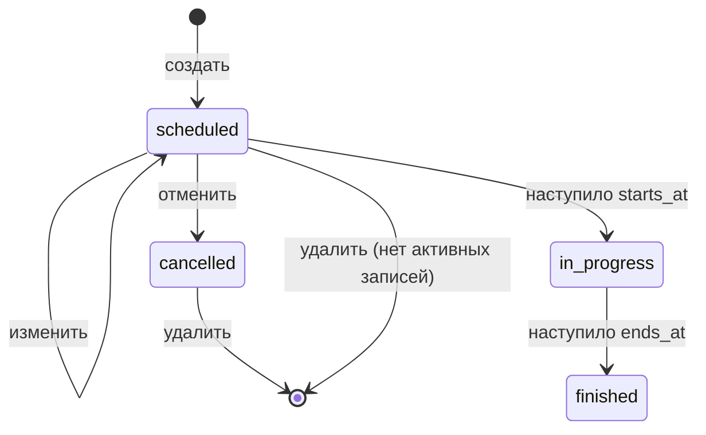
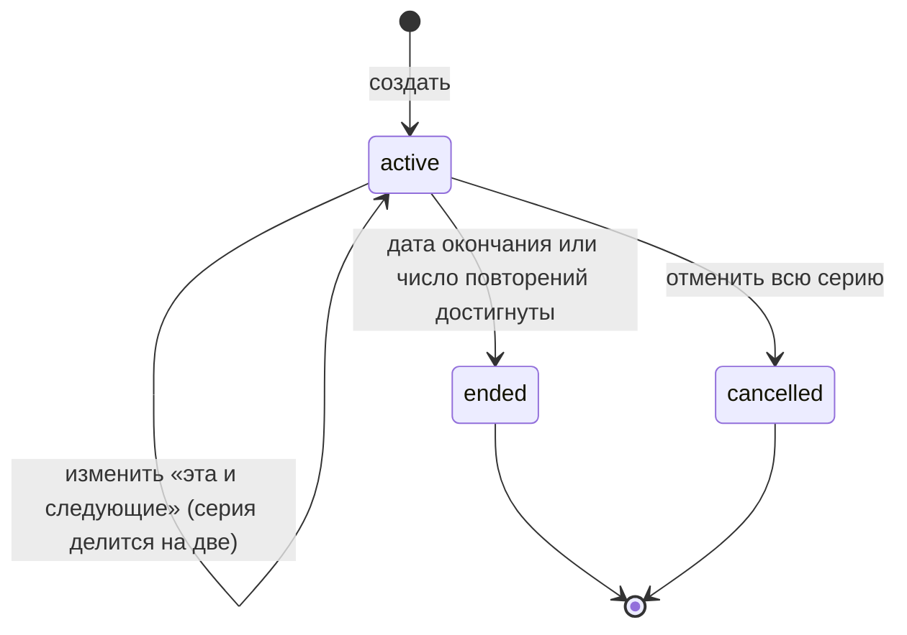
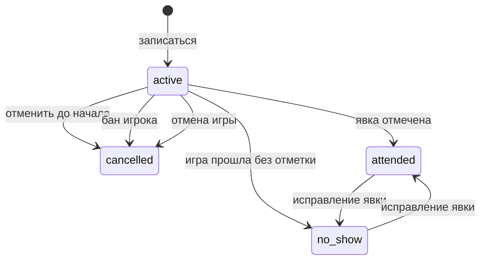
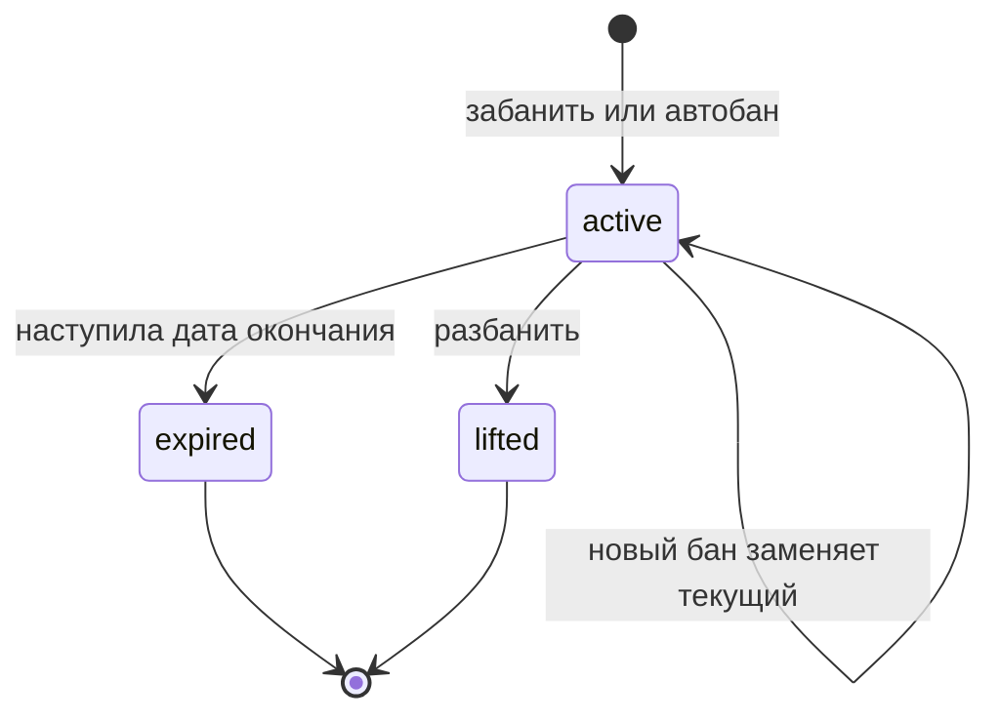

# Предметная область

Язык, сущности, правила и жизненные циклы клуба. Документ — источник терминов для кода, API и событий: имя в коде берётся из колонки «В коде» глоссария.

## Глоссарий

| Термин | В коде | Определение |
|---|---|---|
| Площадка | `venue` | Место с адресом, где есть один или несколько залов |
| Зал | `hall` | Отдельная площадка для игры внутри площадки; в зале одновременно идёт не больше одной игры |
| Игра | `game` | Встреча игроков в зале в заданное время по заданному формату |
| Серия | `series` | Шаблон еженедельно повторяющейся игры |
| Экземпляр серии | `game` с `series_id` | Обычная игра, созданная по шаблону серии |
| Горизонт генерации | `horizon` | На сколько вперёд создаются экземпляры серии (4 недели) |
| Формат | `format` | Правила игры: размер команды и нужен ли связующий в каждой команде |
| Владелец | `owner` | Модератор или админ, создавший игру или серию |
| Открытие записи | `registration_opens_at` | Момент, с которого можно записаться |
| Запись | `registration` | Заявка игрока на участие в игре |
| Порядковый номер | `seq` | Номер записи в игре; задаёт порядок основного состава и листа ожидания |
| Лимит | `main_limit` | Размер основного состава |
| Основной состав | `main roster` | Первые `main_limit` активных записей по `seq` |
| Лист ожидания | `waitlist` | Активные записи после основного состава |
| Перевод | `promotion` / `demotion` | Переход записи из листа ожидания в основной состав или обратно |
| Поздняя отмена | `late cancel` | Отмена из основного состава позже, чем за 3 часа до начала |
| Сила игрока | `strength` | Число для балансировки команд; из опыта и самооценки уровня |
| Перемешивание | `shuffle` | Распределение основного состава по командам |
| Расклад | `team assignment` | Результат перемешивания с номером версии |
| Замена | `substitute` | Игрок команды сверх размера команды |
| Явка | `attendance` | Отметка модератора, что игрок из основного состава пришёл |
| Неявка | `no-show` | Игрок основного состава без отметки о явке |
| Дисциплина | `discipline` | Счётчики неявок и поздних отмен игрока за скользящее окно |
| Бан | `ban` | Запрет записи и изменяющих действий до даты или бессрочно |
| Автобан | `auto ban` | Бан, который система выдаёт по правилу дисциплины |
| Привязка Telegram | `telegram link` | Связь пользователя с `chat_id` в Telegram |

## Сущности и инварианты

Инвариант — правило, которое выполняется всегда, при любом порядке и параллельности запросов. Нарушающий его запрос отклоняется.

### Пользователь (users)

- Email уникален без учёта регистра.
- У пользователя ровно одна роль: `user`, `moderator` или `admin`. Роли упорядочены, права старшей включают права младших.
- Админ появляется только через консоль. Через API нельзя ни выдать, ни снять роль `admin`.
- Профиль: дата рождения в прошлом, рост 100–250 см, опыт 0–60 лет, уровень и амплуа — из перечислений.
- Telegram привязан не больше чем к одному пользователю, у пользователя не больше одной привязки.
- Токен привязки одноразовый и живёт 10 минут.
- Refresh-токен используется один раз. Повторное предъявление уже использованного токена отзывает все refresh-токены пользователя: это признак кражи.

### Бан (users)

- У пользователя не больше одного активного бана. Новый бан при активном заменяет его.
- Модератор банит только роль `user`; админ — `user` и `moderator`; админа не банит никто.
- Срок бана — в будущем или бессрочно; причина обязательна.
- Автобан выдаётся не чаще одного раза за окно дисциплины, и только если активного бана нет.

### Площадка и зал (games)

- У площадки есть хотя бы один зал. Удалить последний зал нельзя.
- Название зала уникально в пределах площадки.
- Зал с играми не удаляется.

### Игра (games)

- `ends_at > starts_at`, длительность от 30 минут до 6 часов.
- `registration_opens_at ≤ starts_at`.
- `main_limit ≥ 1`. Стоимость — целое число копеек, `≥ 0`.
- **Пересечения:** у двух неотменённых игр одного зала интервалы `occupied` не пересекаются. Обеспечивается ограничением исключения в БД, а не проверкой в коде: проверка в коде не защищает от параллельной вставки.
- Формат — только из справочника.
- Отменённая игра не меняется и не возвращается в расписание.
- Удаляется только игра без активных записей или отменённая.
- Время, зал, формат и лимит меняются, только пока игра не началась.

### Серия (games)

- Хотя бы один день недели. Окончание — дата, число повторений или ничего.
- Экземпляры серии не пересекаются друг с другом и с другими играми зала (тем же ограничением исключения). Экземпляр, который пересёкся бы, не создаётся.
- Создание экземпляров идемпотентно: повторный запуск генерации не создаёт дубль на ту же дату.
- Изменение «эта и все следующие» атомарно: если хоть один будущий экземпляр после изменения пересекается с другой игрой, изменение отклоняется целиком со списком конфликтов.

### Запись (games)

- На игру у пользователя не больше одной активной записи. Повторная запись возвращает существующую.
- `seq` строго возрастает в пределах игры и не переиспользуется.
- Записаться можно, только если `registration_opens_at ≤ now < starts_at`, игра не отменена и у пользователя нет активного бана.
- Отменить запись можно до `starts_at`. После начала отмена невозможна: остаётся явка или неявка.
- Состав не хранится, а вычисляется: основной состав — первые `main_limit` активных записей по `seq`, остальные — лист ожидания. Поэтому перевод при отмене и при изменении лимита происходит сам, без перестановки строк. Система только определяет, чья роль изменилась, и сообщает этим игрокам.
- Поздняя отмена засчитывается, только если запись была в основном составе и попала туда раньше, чем за 3 часа до начала. Игрока, переведённого из листа ожидания внутри окна, за отказ не наказывают.

### Расклад (games)

- Перемешивание доступно, если в основном составе не меньше 4 игроков, игра не отменена и не закончилась.
- Каждый запуск создаёт новую версию; актуальна последняя.
- Расклад устарел, если основной состав изменился после перемешивания или изменился формат. Устаревший расклад показывается с пометкой, пока модератор не перемешает заново. При смене формата расклад сбрасывается сразу (ТЗ 3.4.1).

### Явка (games)

- Отмечается только для записей основного состава и только после `starts_at`.
- Исправляется в течение 7 дней после игры; исправление заменяет прежнюю отметку, а не добавляется к ней.

## Жизненные циклы

### Игра

ТЗ называет четыре статуса. Хранятся из них только два: `scheduled` и `cancelled`. `in_progress` и `finished` вычисляются по времени: `starts_at ≤ now < ends_at` и `now ≥ ends_at`. Так не нужна фоновая задача смены статусов, и статус не может отстать от часов.

| Действие | `scheduled` до начала | `in_progress` | `finished` | `cancelled` |
|---|:-:|:-:|:-:|:-:|
| Запись и отмена записи | ✅ (если открыта) | ❌ | ❌ | ❌ |
| Изменение времени, зала, формата, лимита | ✅ | ❌ | ❌ | ❌ |
| Изменение названия и описания | ✅ | ✅ | ✅ | ❌ |
| Перемешивание | ✅ | ✅ | ❌ | ❌ |
| Явка | ❌ | ✅ | ✅ (7 дней) | ❌ |
| Отмена | ✅ | ❌ | ❌ | — |

### Серия

- Деление серии: старая серия заканчивается накануне выбранного экземпляра, новая начинается с него с новыми параметрами. Уже созданные будущие экземпляры переходят в новую серию и получают изменения; записи на них сохраняются.
- Отмена серии отменяет все её будущие экземпляры; прошедшие остаются в истории.

### Запись

- Внутри `active` запись находится в основном составе или в листе ожидания. Это не состояние, а позиция: она вычисляется по `seq` и `main_limit`.
- `cancelled` хранит причину: `self`, `ban`, `game_cancelled`. В дисциплину идёт только поздняя отмена с причиной `self`.
- `no_show` не хранится отдельно: это запись основного состава без явки после окончания игры.

### Бан

- `expired` вычисляется по времени, как статусы игры.
- При бане игрок снимается с будущих игр, которые начинаются до окончания бана. Игры после окончания бана остаются за ним.

## Сценарии по ролям

### Гость
1. Смотрит ближайшие игры в боте: время, зал, формат, «основной состав 10/12, лист ожидания 0». Имён не видит.
2. Видит, когда откроется запись на будущую игру.
3. Регистрируется через API или привязывает Telegram, чтобы стать пользователем в боте.

### Пользователь
1. Привязывает Telegram: получает в API одноразовую ссылку, открывает её в боте.
2. Записывается на игру кнопкой: получает «вы в основном составе» или «лист ожидания, позиция 3».
3. Отменяет запись; если отменил позже чем за 3 часа, бот предупреждает о поздней отмене.
4. Получает уведомления: переход из листа ожидания, изменение или отмена игры, состав команд, напоминание за 24 часа.
5. Смотрит свои игры, свою команду и свою статистику дисциплины.
6. Отключает ненужные типы уведомлений.
7. Будучи забаненным, видит причину и срок бана; записаться не может.

### Модератор
1. Создаёт разовую игру или серию в нужном зале; при пересечении получает игру, с которой конфликт.
2. Меняет свою игру: время, зал, стоимость (записавшимся уходит уведомление), лимит (переводы происходят автоматически).
3. Меняет серию «только эта игра» или «эта и все следующие»; отменяет экземпляр или всю серию.
4. Перемешивает основной состав своей игры, при необходимости повторяет.
5. После игры отмечает явку.
6. Банит и разбанивает пользователей.

### Администратор
1. Всё, что модератор, для любых игр и серий.
2. Управляет площадками и залами.
3. Назначает и снимает модераторов; банит модераторов.
4. Получает роль только через `make admin email=<email>`.

## Решения, уточняющие ТЗ

| ТЗ | Решение | Почему |
|---|---|---|
| Статусы `scheduled → in_progress → finished \| cancelled` (3.4) | Хранятся `scheduled` и `cancelled`, остальные вычисляются | Нет фоновой задачи и рассинхронизации со временем |
| «Изменение влияет только на будущие экземпляры без завершённых игр» (3.5) | Изменение применяется ко всем будущим неотменённым экземплярам, записи сохраняются | Формулировка ТЗ неоднозначна; так игрокам приходят уведомления, а не исчезают записи |
| Конфликт при изменении серии не описан | Изменение отклоняется целиком со списком конфликтов | Частично применённое изменение серии сложно понять и откатить |
| Поздняя отмена (3.6) | Не засчитывается игроку, переведённому из листа ожидания внутри окна в 3 часа | Иначе система наказывает за то, что игрок не мог предвидеть |
| При бане игрок снимается со всех будущих игр (3.11) | Только с игр, которые начинаются до окончания бана | Бан на неделю не должен снимать с игры через месяц |
| Срок исправления явки не задан | 7 дней после игры | Ошибки ловятся в первые дни; дисциплина не меняется задним числом бесконечно |
| Отмена записи после начала не описана | Невозможна | После начала значение имеет только явка |
| `user_roles` (ТЗ, раздел 6) | Одна роль в колонке `users.role` | Роли вложены друг в друга, у пользователя никогда не бывает двух |
